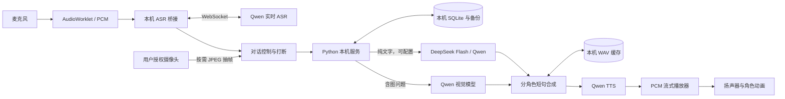

# myProfessor

**本地优先的多角色学习伙伴：实时语音互动、摄像头辅助答疑与持续学习记忆。**

Python 3.10+ · 原生 Web 前端 · SQLite · 本机运行

myProfessor 将英语口语、数学练习、语文学习与多角色对话整合在一个轻量 Web 应用中。前端使用原生 HTML/CSS/JavaScript，Python 本机服务负责模型调用、音频桥接、角色上下文和 SQLite 持久化，不需要前端构建工具或云端数据库。

> **项目状态：可运行的个人学习应用源码，不是经过大规模验证的生产服务。**
> 本公开版本采用通用学习者称呼、伙伴和学科老师，不预置真实儿童姓名与关系。儿童照片、照片衍生头像、声音样本、音色 ID、音频缓存、真实档案、聊天记录和密钥均不分发。语音和形象需自行配置授权素材。请先阅读 [素材与音色配置](docs/SETUP.md)。

## 能力概览

| 能力 | 实现范围 |
| --- | --- |
| 多角色对话 | 三位伙伴同场或独立聊天，语文、英语、数学老师分别答疑 |
| 实时收音 | AudioWorklet、16 kHz PCM、Qwen 实时 ASR、服务端 VAD |
| 打断与恢复 | 识别到讲话时取消旧回答和播放；短时网络故障有限重试 |
| 自然语音 | 六个独立角色音色，短句预合成、PCM 流式播放、本地完整音频缓存 |
| 作业辅助 | 摄像头抽帧理解，区分设备关闭、故障、画面不清和拒绝展示 |
| 本地记忆 | SQLite 完整对话、相关片段检索、家长档案版本、本地规则提取和备份 |
| 基础练习 | 英语、语文、数学及 9×9 乘法练习，不要求模型参与每道题 |

伙伴以闲聊为主，学习内容适量穿插。老师专注各自学科，不与伙伴混淆；`challenger` 是示例伙伴，`math` 才是数学老师。所有角色均为 AI 角色，不是真人连线或真实学校通知。

## 快速开始

推荐 Windows + Python 3.10/3.11 + 当前桌面 Chrome。核心服务也可直接运行在其他具备 Python 的系统上；快捷启动脚本仅面向 Windows。

```powershell
git clone https://github.com/SuperGokou/myProfessor.git
cd myProfessor
python -m venv .venv
.\.venv\Scripts\python.exe -m pip install -r requirements.txt
New-Item -ItemType Directory "$env:LOCALAPPDATA\MyProfessor" -Force
Copy-Item .env.example "$env:LOCALAPPDATA\MyProfessor\.env"
```

在该**私有目录**的 `.env` 中填写自己的 API Key。复制前确认没有覆盖已有配置。示例默认全部对话走 Qwen；要使用 DeepSeek 文本分流，填写 `DEEPSEEK_API_KEY` 并将 `MYPROFESSOR_TEXT_PROVIDER` 改为 `deepseek`。

```powershell
.\START_MYPROFESSOR.cmd
```

启动器在 `8765–8785` 中寻找可用端口，复用已经运行的本应用并打开浏览器。亦可直接启动：

```powershell
.\.venv\Scripts\python.exe learning-server.py --port 8765
```

访问 [http://127.0.0.1:8765](http://127.0.0.1:8765)，由用户主动开启麦克风和摄像头。仅双击 HTML 可以体验基础页面，但 AI API 需要本机服务。GitHub Pages 不能运行这个 Python 后端。

## 系统架构



详细设计见 [架构说明](docs/ARCHITECTURE.md)，包括时序图、模块职责、并发与取消、状态边界、容量限制和取舍。接口字段与错误语义见 [API 文档](docs/API.md)。

## 模型与配置

| 环节 | 当前实现 | 说明 |
| --- | --- | --- |
| 文字对话 | `deepseek-flash` 或 `QWEN_MODEL_NAME` | DeepSeek 路由关闭思考模式 |
| 摄像头理解 | `QWEN_MODEL_NAME`，示例为 `qwen-vl-max` | 必须选支持图像的模型 |
| 实时识别 | `qwen3-asr-flash-realtime` | 中国内地 DashScope 地址 |
| 克隆音色 | `qwen3-tts-vc-2026-01-22` | 需要合法授权素材和自己的音色 ID |
| 设计音色 | `qwen3-tts-vd-2026-01-26` | 音色与合成模型必须匹配 |

模型名称、权限、区域及价格由供应商维护，应以账户实际调用结果为准。本项目不替用户切换计费开关。云端能力不是“下载一些缓存”就能离线替代的。

## 数据与隐私

- 数据库、档案、记忆提取、备份与音频缓存保存在本机。Windows 默认目录为 `%LOCALAPPDATA%\MyProfessor`。
- 每次调用仍会把当前内容和少量必要上下文发给对应 API 服务商。实时识别发送音频，视觉问答发送当前 JPEG，语音合成发送台词。
- 应用不保存原始收音或摄像头帧；最终转写、回答和图片指纹会记录在本地。授权音色参考音频是家长另行配置的私有文件。
- 本地数据库**不是加密数据库**。访问令牌与回环绑定不是多用户身份认证，不能阻止已控制本机账户的软件读取数据。
- 不从脸部推断情绪、智力或注意力，不用文字转写冒充发音评分。摄像头关闭或故障时不能声称仍看得见。

详见 [数据与安全边界](docs/PRIVACY.md) 和 [安全报告说明](SECURITY.md)。请家长陪同使用，避免录入地址、联系方式等非必要信息。

## 测试

无需真实 Key 的后端与播放器测试：

```powershell
python -m unittest test-learning-server.py test-learning-voice.py test-learning-realtime.py
npm ci
npm test
```

浏览器集成测试需要先启动本机服务，再安装 Chrome 或 Playwright Chromium：

```powershell
npx playwright install chromium
$env:PLAYWRIGHT_CHANNEL = "chromium"
npm run test:realtime
npm run test:recovery
npm run test:interaction
npm run test:layout
npm run test:motion
```

测试路由模拟云端与麦克风设备，不应使用孩子的真实收音作为测试输入。[测试与排障文档](docs/TESTING.md) 说明覆盖范围、真实 API 测试的成本与数据隔离要求。CI 模板已提供；当前上传凭据没有 `workflow` scope，因此尚未启用 GitHub Actions，不能把本地测试结果当成云端 CI 结果。

## 项目结构

```text
learning-server.py              本机 HTTP API、角色编排与持久化
learning_realtime.py            Qwen ASR WebSocket 会话
learning_voice.py               音色、TTS、完整音频缓存
multiplication-game.html        页面入口
learning-assets/                学科、对话、播放器和动画代码
start-myprofessor.ps1                Windows 启动器
test-*.py / test-*.cjs          回归测试
docs/                          架构、配置、接口、隐私与排障
docs/ci-tests.yml               无真实凭据的 CI 模板（尚未启用）
```

## 已知限制

本项目不是端到端实时语音模型：识别、文本生成和合成仍存在串联等待。流式播放只能减少等整段生成的时间，不能保证每轮一秒开口。真实儿童口音、回声、弱网、浏览器休眠和长时会话仍需场景测试。图片是抽帧而非连续视频感知。模型可能回答错误、重复或混淆角色，提示和过滤不提供绝对保证。

目前不提供多账户隔离、互联网部署、远程访问认证、完整离线语音模型或自动学业评估。永久保留历史不等于每轮都能完美回忆。公开源码未附私有形象和音色，也没有将历史测试截图作为通用效果保证。

## 贡献与授权

提交问题时请提供可复现步骤、去标识化错误码及环境版本，不要上传儿童音视频、聊天档案或密钥。参见 [贡献指南](CONTRIBUTING.md)。

当前未选择开源许可证；公开可见不等于授予任意再分发许可。角色素材、声音和第三方内容的授权应单独核实，后续许可证由仓库维护者决定。
