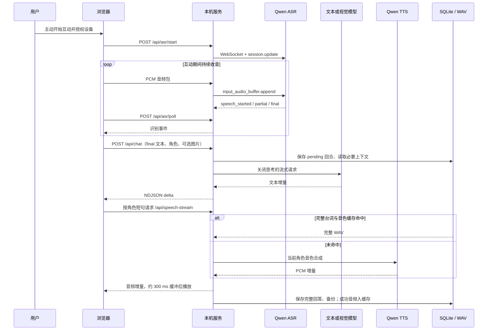
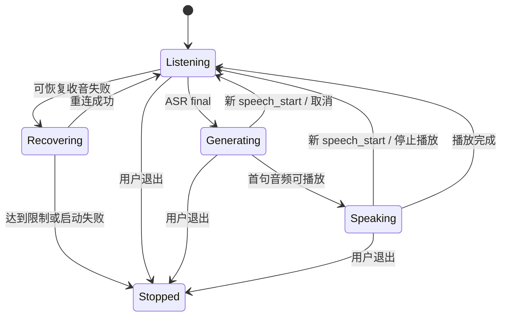

# 架构设计

## 1. 设计目标与边界

myProfessor 是单台电脑、单个家庭使用的 local-first 学习应用。设计目标是保留长期互动连续性，在不同角色之间保持任务与音色边界，并减少语音对话中可避免的等待。

不把模型当数据库，不让前端持有供应商密钥，不把一次识别成功等同于完整学习评估。当前实现不包含多租户、远程登录、云端记忆、端到端加密或连续视频理解。Python 标准库 HTTP 服务适合本机运行，不应直接暴露到互联网。

## 2. 模块职责

| 模块 | 主要职责 | 不负责 |
| --- | --- | --- |
| `multiplication-game.html` | 页面结构、入口和控件 | API 密钥与长期记忆 |
| `learning-assets/app.js` | 学科视图、基础练习、进度展示 | 云端角色编排 |
| `learning-assets/chat.js` | 回合生命周期、角色选择、摄像头、ASR 事件、播音队列 | 数据库写入 |
| `realtime-microphone.js` | 麦克风权限、音频图、上传、轮询、失败清理 | 模型回复 |
| `microphone-worklet.js` | 16 kHz PCM 分包，约每 100 ms 输出 | 语义识别、持久化 |
| `speech-player.js` | PCM 解码、缓冲、Web Audio 调度、取消 | 语音内容推理 |
| `avatar.js` / CSS | 角色呈现、稳定布局、眨眼、说话状态 | 判断孩子情绪 |
| `learning-server.py` | 受限 HTTP API、上下文、模型路由、SQLite、备份 | 远程账户认证 |
| `learning_realtime.py` | 短生命周期的 Qwen WebSocket ASR 会话 | 保存原始收音 |
| `learning_voice.py` | 音色绑定、合成、流异常、完整 WAV 缓存 | 学习记忆清理 |

## 3. 一轮语音互动

ASR、文本和 TTS 是三个独立阶段，不是一个端到端全双工语音模型。音频上传可以与播放并行，但文本回复通常要等 final 转写。首句形成后可启动 TTS，不等待整个回答结束。

## 4. 收音与重连

浏览器开启 `echoCancellation`、`noiseSuppression` 与 `autoGainControl`。AudioContext 请求 16 kHz；设备不支持该采样率时明确失败，不发送错误采样数据。AudioWorklet 输出 Int16 PCM，前端串行上传以保证顺序。

单包约 100 ms，上传积压时最多把 5 包合并为 500 ms 请求，服务端上限为 16000 字节 PCM。队列上限 30 包，即约 3 秒；超过后停止并尝试恢复，而不是无限积压或静默丢包。正常网络不故意等待凑够 5 包。

ASR 使用服务器 VAD：阈值 `0.2`、句尾静音 `450 ms`。较低静音阈值减小等待，但可能切断孩子的思考停顿，后续应通过真实使用样本调整，不应单纯越短越好。

每分钟最多自动恢复 3 次运行时故障。麦克风设备结束事件直接提示用户检查设备，不把持续断开的硬件当网络循环重试。建连阶段暂时性异常补试一次，HTTP 400/401/403 不补试。前端请求有超时，退出时取消请求、关闭音轨和 AudioContext，并通知服务端释放会话。

服务端最多 2 个麦克风会话；30 秒没有音频则释放。建连不持有全局会话注册锁，避免一个新连接阻塞已存在连接的音频上传。部分转写和音频只在内存，关闭时清空事件队列；保留独立错误码用于诊断。

## 5. 打断与过期回答

前端使用回合版本、AbortController 和当前播音批次引用共同防止旧结果重新播放。`speech_start` 停止声音并取消旧请求；final 转写发起新请求。服务端 `ACTIVE` 保存请求 ID 对应的取消事件，必要时关闭上游 socket，使阻塞读退出。

数据库 `pending` 状态在开始调用前写入。成功回答才成为 `complete`，取消或失败记录为 `failed`。同一个请求 ID 的已完成重试返回已保存结果，不重复插入；内容不一致或同一回合仍处理中返回冲突。

限制：模型完成不等于用户完整听到了回答。播放过程中被打断时，已经保存的回答可能有未听到的后半段，目前没有逐句“已听到”数据库确认协议。

## 6. 模型路由与角色隔离

纯文字请求在配置 DeepSeek 路由时使用 `deepseek-flash`，`thinking.type=disabled`；含 `image_url` 的请求始终使用配置的 Qwen 视觉模型。没有自动切换计费开关，也不自动尝试任意未验证的模型 ID。

公开版使用以下通用角色 ID：

| ID | UI 示例角色 | 任务 |
| --- | --- | --- |
| `dark` | 星星伙伴 | 学习者的伙伴，闲聊与适量学习 |
| `challenger` | 探索伙伴 | 友好竞争的同龄虚构伙伴，不催作业 |
| `light` | 阳光伙伴 | 探索伙伴的伙伴，轻松互动 |
| `chinese` | 语文老师 | 语文作业 |
| `english` | 英语老师 | 英语作业与口语示范 |
| `math` | 数学老师 | 数学作业 |

单聊限定一个角色，多人默认一个角色主答、最多另一位简短接话。老师只在明确需要时加入，不能把老师作业规则套到伙伴身上。后端 `allowed_speakers` 与前端标签检查限制实际播音角色；音色键独立绑定，单句失败补播不能换成另一个人物的声音。

上下文避免回放其他角色的旧台词；孩子已说过的信息可作为带来源的参考数据共享。老师近期自动引导作为参考数据保留，使“不放”等短句能联系上一条展示要求。对于明确拒绝展示的回复，本轮去掉图片，优先回应语义，暂停前端自动看图追问。

提示词、行标签和英语谐音过滤都是防护层，不是形式化正确性保证。教师语气不能冒充现实学校通知，不能因设备故障或不愿拍摄施加处罚。

## 7. 摄像头边界

只有用户操作才能申请摄像头。普通伙伴闲聊不附带图像；看图问题或手动展示发送 JPEG。老师可按需附帧，符合空闲条件时每 8 秒检查是否需要自动观察，但不保证每 8 秒都会发请求。

请求中的 `camera_state` 是发送时状态，图片也只是一个时间点。拒绝展示、选择语音答题或设备故障时停止自动追问；手动展示可恢复。图像不入库，只记录指纹。模型只能检查当前可见内容，不能据此宣称全部作业正确、孩子专注或情绪如何。

## 8. 语音缓存与播放

缓存键包含模型、音色 ID 和完整台词。同样文字换音色不得命中旧缓存。成功合成才原子写入 WAV，截断或失败的音频不入缓存。每角色最多 1000 条、256 MiB，清理缓存不删除学习记忆。

实时流在尚未发布 PCM 时允许短暂错误重试；一旦已经发布音频，不从头自动重播，避免用户听到重复句。前端约积累 7200 个 24 kHz 样本（300 ms）后开始，后续音频按 Web Audio 时间线调度；短句提前结束则直接播放。

缓存仅加速相同台词，无法预生成无限开放对话。网络供给慢于播放速度仍可能欠缓冲；更大的缓存目录并不是首音频延迟的通用解法。

## 9. 并发与容量

| 约束 | 当前值 / 行为 |
| --- | --- |
| 本机服务 | ThreadingHTTPServer，回环绑定 |
| 活跃模型回合 | 最多 8 个；入库锁不跨模型网络等待 |
| 语音并发 | 服务端信号量 3 |
| ASR 会话 | 最多 2；建连中的会话也计数 |
| ASR 事件队列 | 最多 100；轮询一次最多取 30 个 |
| ASR 请求体 | 最多 24000 字节 JSON |
| 图片有效载荷 | 最多 768000 字节 JPEG |
| 对话消息 | 1–2000 字符 |
| 最近上下文 | 最近 6 回合及最多 3 条相关历史 |

这些是本机防护上限，不是互联网抗滥用或多用户配额设计。

## 10. 后续演进

优先补充长期真实网络指标、ASR 方言与儿童停顿测试、播放确认、可配置角色档案、加密和恢复演练。若转为远程部署，需要重新设计身份认证、租户隔离、TLS、限流、媒体上传权限、审计与数据删除流程，不能仅改监听地址。
